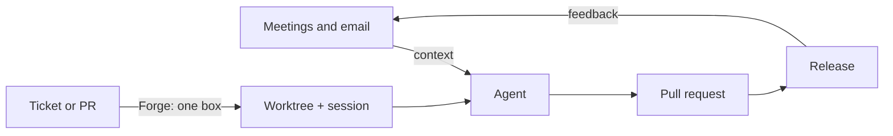

# Forge

A software factory for Tern: what to build comes in from meetings and email, gets
worked on by agents in their own worktrees, ships as pull requests, and comes back as feedback.
Every step stays one keystroke from the terminal.



Each part is its own Tern plugin. Install only what you use; they work alone and get better together.

| Plugin | What it does | Install |
|---|---|---|
| [**Projects**](projects/) | Projects sidebar (plugin id `forge`): repositories, their Git worktrees (stacked ones too), a session per worktree, PRs with CI and review, and Linear tickets that move with the work. One box opens or creates a worktree from a branch, a ticket, a PR or a new ticket's title, and can start an agent on it. Also shows Claude and ChatGPT subscription usage. | `tern plugin install github.com/Moti-Velz/tern-forge/projects` |
| [**Meetings**](meetings/) | Notes, transcripts and email threads from Granola, Fireflies, IMAP or a folder of exports, gathered from the keyboard and pasted into your agent. | `tern plugin install github.com/Moti-Velz/tern-forge/meetings` |
| [**Omarchy**](omarchy/) | Tern on [Omarchy](https://omarchy.org/)/Hyprland: window keys act on Tern panes first and pass to Hyprland at the edge; desktop notifications when agents finish or need you. | `tern plugin install github.com/Moti-Velz/tern-forge/omarchy` |

To hack on them, clone once and link the plugins you want. Linked plugins reload when their source
changes:

```sh
git clone https://github.com/Moti-Velz/tern-forge ~/src/forge
tern plugin link ~/src/forge/projects
tern plugin link ~/src/forge/meetings
```

## How they fit together

Tern plugins can't run each other's commands, so they share plain, documented contracts instead.
Anything else (an agent, a script, Carly) can use the same ones.

| Contract | Owner | Used by |
|---|---|---|
| `git config branch.<branch>.forge-ticket <ENG-123 or Linear URL>` links a branch to its ticket. Repository-local, never pushed. | Projects | Projects' Open box and **Link ticket**, `forge-links`, agents |
| `git config branch.<branch>.forge-parent <branch>` stacks a branch on another (its worktree shows indented under the parent's). | Projects | **New stacked worktree**, agents |
| `forge-links list / show / link / unlink KEY`: every worktree with its branch, ticket and PR, by any key (path, branch, ticket, PR number or URL). | [projects/bin/forge-links](projects/bin/forge-links), skill [projects/skills/forge-links](projects/skills/forge-links) | Agents |
| Carly exports `worktrees(key?)` and `link_ticket(key, ticket?)` | Projects | Carly |
| Bracketed paste into the agent's composer (long content goes to a file and is referenced) | Meetings | Any agent in Tern |
| Super+Alt+Shift+P toggles Projects | Projects | Omarchy's Super+B |

## Layout

Each directory is a complete plugin with its own `plugin.toml`, README, changelog and tests. The
histories of the original repositories (`tern-forge`, `tern-meetings`, `tern-omarchy`) are kept in
full. Plugins are versioned on their own: tags look like `projects-v3.2.0`. Projects keeps the plugin id `forge`, so its actions (`plugin.forge.*`) and data (`plugin-data/forge`) are unchanged.

## License

MIT. See [LICENSE](LICENSE). Projects started as a fork of
[Overseer](https://github.com/mmnavarr/overseer) and keeps its original notice in
[projects/LICENSE](projects/LICENSE).
