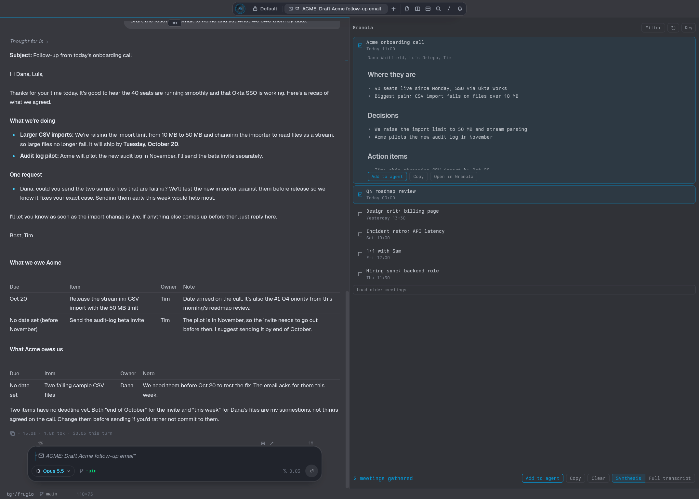

# Granola for Tern

Your Granola meetings in a panel beside the terminal. Press **Alt+G**, pick meetings with the arrow
keys and Space, and press Enter to add them to the agent you're working with, as the AI synthesis or
with full transcripts.



## Install

```sh
tern plugin install https://github.com/Moti-Velz/tern-granola
```

You need a Granola **personal API key**, which requires a Business or Enterprise plan. Create one in the Granola app under
**Settings › Connectors › API keys**. Then press `K` in the panel or run **Granola: Set API key** from
the palette. The key goes into the system keychain (`plugin.granola.api-key`).

## Use

**Alt+G** jumps into the meetings panel, opening it beside you the first time. Press it again, or
`Esc`, to jump back to the agent. Inside the panel:

| Key | Does |
| --- | --- |
| `↑` `↓` / `j` `k` | Move. Moving past the last meeting loads older ones |
| `Space` | Gather or release the meeting (✓) |
| `Enter` | Add the gathered meetings, or the one under the cursor, to the agent |
| `→` / `←` | Show or hide the preview: attendees and summary of the meeting under the cursor |
| `Tab` | Switch between **Synthesis** and **Full transcript** |
| `/` | Filter by title, owner or attendee as you type. `Enter` keeps the filter, `Esc` clears it |
| `c` / `o` | Copy as Markdown / open in Granola |
| `x` / `r` / `K` | Clear the gathered meetings / reload / set the API key |
| `g` / `G` | Top / bottom |
| `?` | Show all keys. The common ones are always listed at the bottom of the panel |

The mouse works too: click a meeting to select it and double-click to gather it. The bottom bar has
**Add to agent**, **Clear** and the **Synthesis | Full transcript** switch.

**Adding to the agent** puts the meetings into the composer of the agent you last worked in,
without sending, and focuses it, so you just type your question. If you haven't used an agent yet,
the newest agent in the panel's tab is used. If there isn't one, an agent starts in the directory you
were working in, with the meetings as its first message.

The context is one Markdown document with each meeting, oldest first. Each meeting has its time,
attendees, folders, Granola link, summary and private notes, plus the transcript in Full transcript
mode. Up to 6000 characters, it is pasted inline inside `<granola-context>`. A longer one is written to
`<plugin data>/context/<timestamp>-<title>.md`, and only that path is added to the composer.

If something else already uses Alt+G, rebind `plugin.granola.meetings` in Tern's keybinds.

## Carly

The plugin gives Carly two exports and one piece of context:

- `plugins.granola.recent()` returns recent meetings as `{id, title, when}`.
- `plugins.granola.note(id, transcript?)` returns one meeting as Markdown.
- Context: the titles of the meetings currently gathered in the panel, so you can say things like
  "add these to the frugio agent".

## Notes

- Granola's API only returns meetings that already have an AI summary and transcript. Meetings
  still being processed don't show up.
- Requests stay well under the rate limit of 5/s: gathered notes are fetched one at a time, and previews are
  cached for the window's lifetime. A transcript too large to come inline (`413`) is fetched page by page from
  `/v1/notes/{id}/transcript`.
- `GRANOLA_API_BASE` in Tern's environment points the client at a different server, such as a proxy or a
  stub. The default is `https://public-api.granola.ai`.

## Files

| File | Role |
| --- | --- |
| `host.luau` | The `granola.meetings` block: keys, mouse events, selection, gathered meetings, preview, filter |
| `window.luau` | Service for the block: API key, Granola requests, pasting into the agent, focus, Alt+G, Carly exports |
| `lib/api.luau` | Granola API client (`/v1/notes`, `/v1/notes/{id}`, transcript paging) |
| `lib/context.luau` | Pure: dates, speaker labels, the Markdown context document and composer attachment |
| `lib/view.luau` | Pure: the block's view |
| `styles.css` | Panel styling (`data-role='granola.*'`) |
