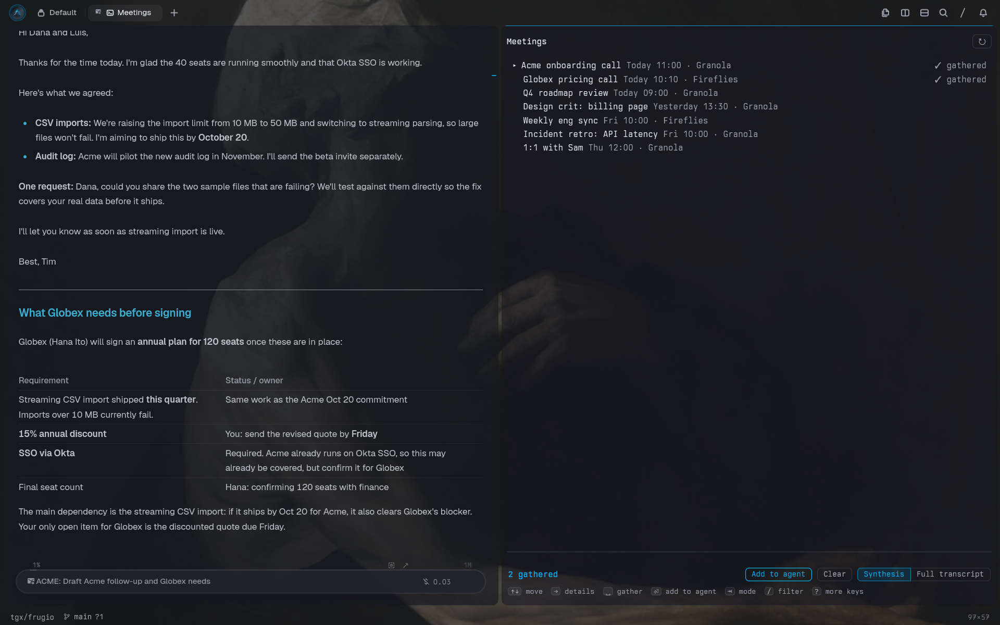

# Meetings for Tern

Notes, transcripts and email threads in a panel beside the terminal. Supported sources are
**Granola**, **Fireflies**, **email over IMAP** (Gmail, Fastmail, iCloud, Outlook…) and **a folder of
exported files** from any recorder. Press **Alt+G**, pick items with the arrow keys and Space, and press
Enter to add them to the agent you're working with, as the AI synthesis or with full transcripts.



## Install

```sh
tern plugin install github.com/Moti-Velz/tern-forge/meetings
```

Then press **Alt+G** and `K`, or run **Meetings: Connect a source** from the palette, and connect any
of these:

| Source | What you need |
| --- | --- |
| **Granola** | A personal API key (Business or Enterprise plan): Granola › **Settings › Connectors › API keys** |
| **Fireflies** | An API key: app.fireflies.ai › **Integrations › Fireflies API**. Free plans get 500 requests a day, which is plenty here |
| **Local folder** | A folder of exports: Markdown notes (`.md`), plain text (`.txt`) and captions (`.vtt`, `.srt`) |
| **Email** | Your address and an app password. Gmail: turn on 2-step verification, then create one at myaccount.google.com/apppasswords. Needs `python3` |

API keys and the email login go into the system keychain (`plugin.meetings.granola-key`, `plugin.meetings.fireflies-key`, `plugin.meetings.email-account`). The folder path goes into the plugin's
settings. Connecting a source again with an empty answer disconnects it. Items from every connected
source are listed together, newest first, each tagged with its source. Email threads get their own **Email** tab.

**Email:** each item is a thread from the last 45 days: Gmail's own threads (searched across All Mail,
so your replies are included), or messages grouped by subject elsewhere. Its details are every message,
oldest first, with quoted history removed and attachments listed by name. The mailbox is opened
read-only, so nothing is marked as read. The server is guessed from your address's domain. For other
domains, add it after a space: `you@acme.com imap.acme.com` (TLS on 993, or `host:port`). Google
Workspace addresses use `imap.gmail.com`.

Connecting Email again adds another account rather than replacing the first. Threads from every
account share the Email tab, and each row names its account once there's more than one.

**Local files:** a name starting with a date, such as `2026-10-12 14-00 Acme call.md`, dates the
meeting, with the time read as local time. The first `# ` heading becomes the title, or else the rest
of the name. Markdown and prose count as the summary. Captions, and text files made mostly of
`Name: text` lines, count as a transcript. Zoom, Google Meet, Teams, Otter, MacWhisper and most
recorders can export one of these.

## Use

**Alt+G** jumps into the meetings panel, opening it beside you the first time. Press it again, or
`Esc`, to jump back to the agent. Inside the panel:

| Key | Does |
| --- | --- |
| `↑` `↓` / `j` `k` | Move. Moving past the last meeting loads older ones |
| `Space` | Gather or release the meeting (✓) |
| `Enter` | Add the gathered meetings, or the one under the cursor, to the agent |
| `→` / `←` | Open the details of the meeting under the cursor (attendees, full summary, actions) / back to the list. In details, `↑` `↓` step through meetings |
| `Tab` / `1` `2` | Switch between the **Meetings** and **Email** tabs. Gathered items stay gathered across both, so one paste can hold a call and its email thread |
| `t` | Switch between **Synthesis** and **Full transcript** |
| `/` | Filter by title, owner or attendee as you type. `Enter` keeps the filter, `Esc` clears it |
| `c` / `o` | Copy as Markdown / open where it lives (web page or file) |
| `x` / `r` / `K` | Clear the gathered meetings / reload / connect a source |
| `g` / `G` | Top / bottom |
| `?` | Show all keys. The common ones are always listed at the bottom of the panel |

The mouse works too. Click a meeting to select it and double-click to open its details. The bottom bar
has **Add to agent**, **Clear** and the **Synthesis | Full transcript** switch.

**Adding to the agent** puts the meetings into the composer of the agent you last worked in, without
sending, and focuses it, so you just type your question. If you haven't used an agent yet, the newest
agent in the panel's tab is used. If there isn't one, an agent starts in the directory you were working
in, with the meetings as its first message.

The context is one Markdown document with each meeting, oldest first. Each meeting has its time,
attendees, source and link, summary and private notes. In Full transcript mode it also has the
transcript, and so does any meeting that has only a transcript. Up to 6000 characters, the document is
pasted inline inside `<context>`. A longer one is written to
`<plugin data>/context/<timestamp>-<title>.md`, and only that path is added to the composer.

If something else already uses Alt+G, rebind `plugin.meetings.toggle` in Tern's keybinds.

## Carly

The plugin gives Carly two exports and one piece of context:

- `plugins.meetings.recent()` returns recent meetings from all sources as `{id, title, when, source}`.
- `plugins.meetings.note(id, transcript?)` returns one meeting as Markdown.
- Context: the titles of the meetings currently gathered in the panel, so you can say things like
  "add these to the frugio agent".

## Notes

- Granola's API only returns meetings that already have an AI summary and transcript.
- Requests are sparing. Lists ask only for light fields, meetings are fetched one at a time, details are
  cached for the window's lifetime, and Fireflies sentences are only requested in Full transcript mode.
- `GRANOLA_API_BASE` and `FIREFLIES_API_BASE` in Tern's environment point the clients at a different
  server, such as a proxy or a test stub.
- Upgrading from the old `tern-granola` plugin (id `granola`): remove it with `tern plugin remove granola`,
  install this one, and connect Granola again. Keys can't move between plugin ids.

## Adding a source

A source is a module in `lib/sources/` that returns a `source.Def`: an id, a display name, what it
connects with (a secret or a path), and two functions. `list(cred, cursor, done)` returns a page of
meetings. `note(cred, id, transcript, done)` returns one meeting in full. Both return the meeting shape
documented in `lib/sources/source.luau`. Register the module in the `SOURCES` table in `window.luau`
and add its display name to `context.SOURCES`.

## Files

| File | Role |
| --- | --- |
| `host.luau` | The `meetings.panel` block: keys, mouse events, selection, gathered meetings, list and details screens, filter |
| `window.luau` | Service for the block: credentials, source requests, pasting into the agent, focus, Alt+G, Carly exports |
| `lib/sources/` | `granola`, `fireflies`, `local` and `email` sources (`email_imap.py` does the IMAP work), and `source.luau`, the contract they share |
| `lib/link.luau` | The internal links the block and the window half talk through |
| `lib/context.luau` | Pure: dates, speaker labels, the Markdown context document and composer attachment |
| `lib/view.luau` | Pure: the block's view |
| `styles.css` | Panel styling (`data-role='meetings.*'`) |

## License

MIT — see [LICENSE](LICENSE).
