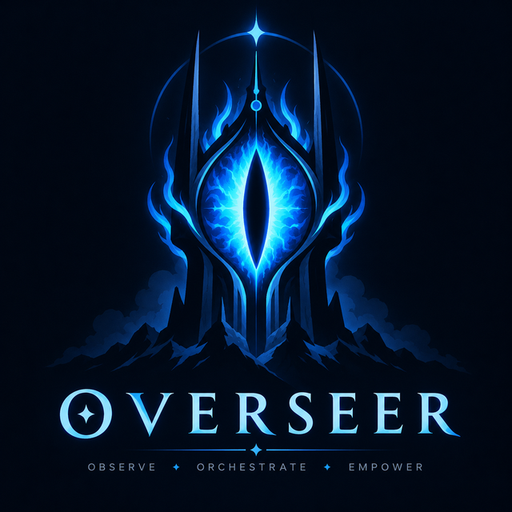
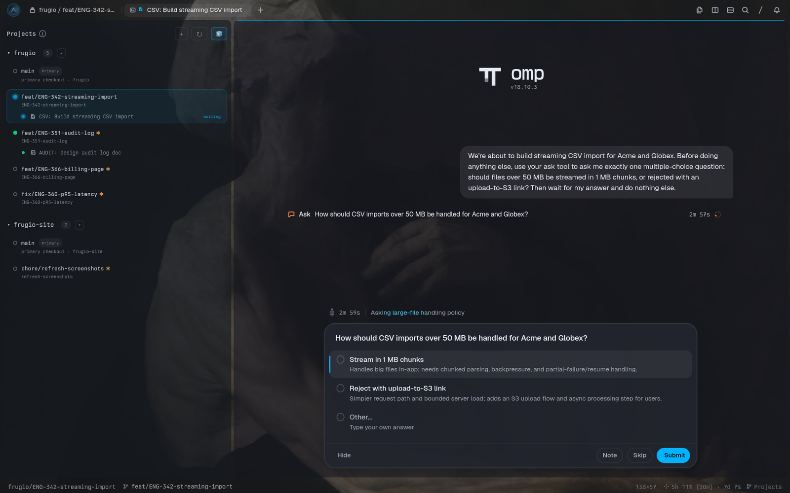
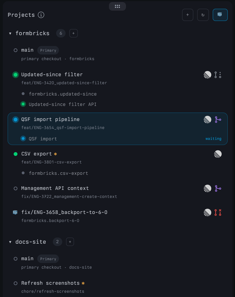
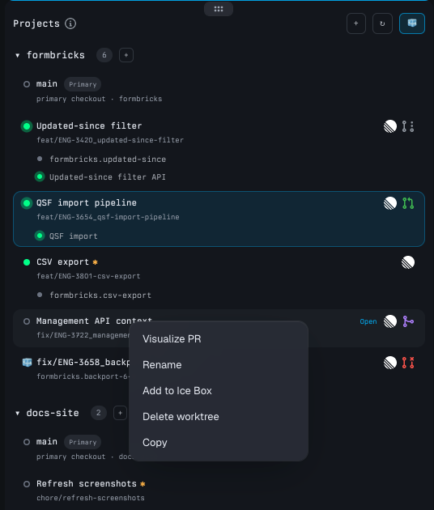
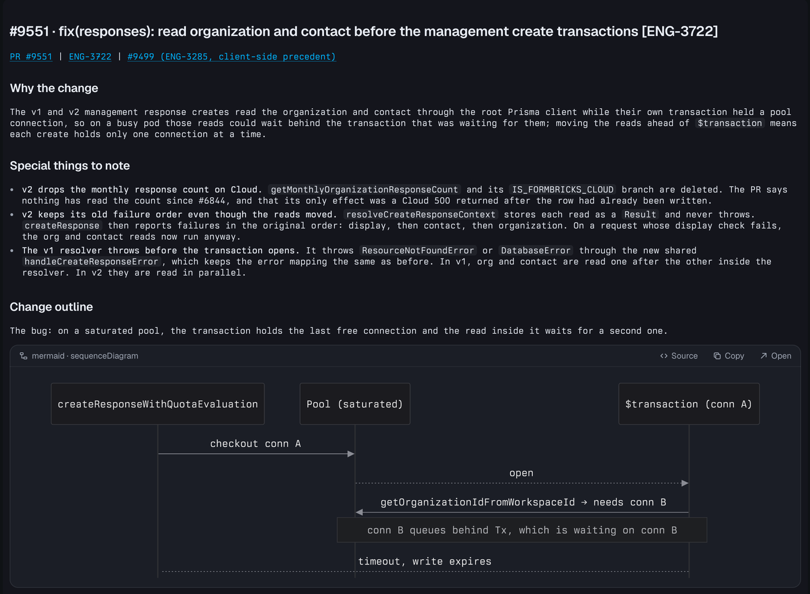
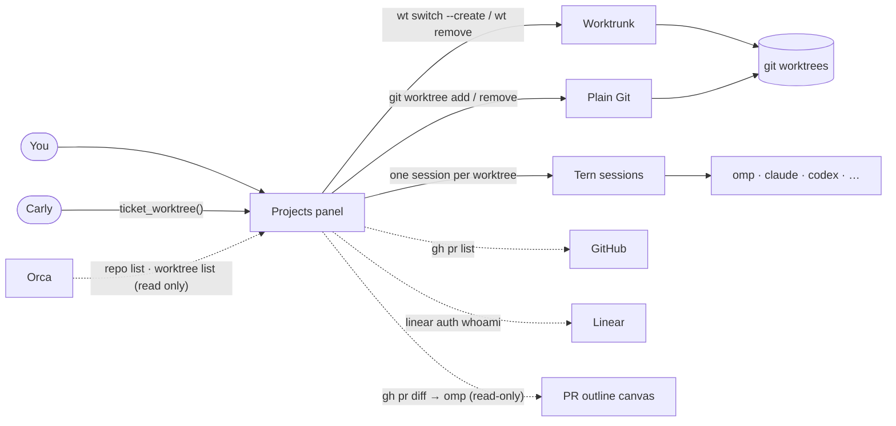

<div align="center">

<h1></h1>

**Mission control for parallel agent work.**

Forge started as a fork of [Overseer](https://github.com/mmnavarr/overseer) by mmnavarr (MIT).

One panel for every branch you have in flight: its worktree, its agents, its pull request and its ticket.<br>
Click a row and you're in that branch's own workspace.



</div>

---

Running five agents on five branches means five checkouts, a pile of terminals, and losing track of which agent is stuck waiting for you. Forge is a [Tern](https://docs.stencil.so/tern/) plugin that fixes that:

- **Every worktree gets its own Tern session.** Its tabs, shells and agents live there. Switching branches is one click, and nothing bleeds between them.
- **You can see what every agent is doing.** A pulsing dot means an agent is working; a blue dot means one is waiting for you.
- **PRs and tickets sit on the row.** GitHub PR state (draft, open, merged, closed) and the Linear ticket, both one click away.
- **Worktrees come and go safely.** Forge creates and deletes worktrees itself, in the background, with [Worktrunk](https://worktrunk.dev) or plain Git, with your hooks and approvals intact.
- **Orca is a source, not a backend.** Repositories registered in Orca join Projects on their own. Their worktrees' names, comments, board status, setup scripts and Linear links are read in. Forge never writes to Orca.
- **Agents can start work for you.** Tell Tern's assistant *"Create a forge worktree for ENG-123"* and you get a branch, a session and an [omp](https://omp.sh) agent already reading the ticket.
- **PRs can be understood at a glance.** **Visualize PR** turns a pull request into a diagram-first outline, without touching GitHub.

## Subscription usage

Forge also shows your Claude and ChatGPT subscription usage. The status bar shows it first, with a sparkle icon, like `5h 2% (1h56m) · 7d 3%`. The segment is tinted warn at 60% and error at 85% of the worst window. Click it to open the usage panel, docked beside the focused pane at full height (click again to close it), which shows the 5 h and 7 d windows for every account. Claude Pro/Max also shows per-model weekly limits and extra usage; ChatGPT/Codex also shows credits. A muted **Projects** segment after it toggles the Projects panel.

Accounts come from Claude Code and Codex CLI credentials, omp logins, and OAuth logins made in the plugin (several accounts are allowed). You can give accounts aliases, hide them, reorder them, pin the usage to the status bar, and choose compact or card layouts. Usage is polled in the background, even while the panel is closed.

Three palette commands control it:

- **Subscription usage (Claude / GPT): show or hide the panel** (`plugin.forge.usage`)
- **Claude usage: sign in to a subscription account (several allowed)** (`plugin.forge.usage-login`)
- **GPT usage: sign in to a ChatGPT account (several allowed)** (`plugin.forge.usage-login-gpt`)

Like upstream, Forge can write refreshed OAuth tokens back to Claude Code's `~/.claude/.credentials.json` (and Codex's credentials) when it refreshes them.

Subscription usage is integrated from [tern-claude-usage](https://github.com/zerx-lab/tern-claude-usage) by zerx-lab (MIT). Its code lives in `usage/` with its own LICENSE, and its UI is translated to English.

## The panel

The panel stays with you: it sits on the left of whichever tab you're looking at, across every session, and keeps the width you give it. Each project is a local Git repository. Under it, every worktree is a row, and under each row are its open tabs. Rows are ordered by what they need from you: **needs you** first, then working, in progress, in review, idle, and done at the bottom; within each, the most recently used or committed first. Stacked worktrees sit indented under their parent. Click a tab to jump straight to it. Hover a row for its branch, path, line counts, ahead/behind and PR. For projects registered in Orca, the hover also shows Orca's board status and comment; Orca's display name is used when you haven't named the row, and the ticket badge can come from Orca's linked Linear issue when the branch name has no ticket id.

<table>
<tr>
<td width="50%"></td>
<td width="50%">

| You see | It means |
|---|---|
| ● green | A session is open |
| ● green, pulsing | An agent is working |
| ● blue, haloed | An agent is waiting for your answer |
| ○ hollow | No session yet; click to open one |
| **✱** amber | Uncommitted changes |
| **conflicts** | A merge or rebase is stuck |
| Linear logo | The branch is linked to a ticket (**Link ticket**, an agent, or copied from Orca), or its name contains one (`feat/ENG-123-…`) |
| PR icon | Draft, open, merged or closed PR |
| **needs you** | An agent waits for you, a merge is stuck, CI is failing or changes were requested on the PR |
| **working** · **in progress** · **in review** · **done** | An agent is working · uncommitted work, commits ahead of the base or a draft PR · the PR is open · the PR merged or closed |
| **Delete** | The PR merged: one click (and a confirmation) removes the worktree |
| Indented under another row | Stacked work: the branch was created on top of that worktree's branch, or its PR targets it |

</td>
</tr>
</table>

## Install

You need macOS or Linux and:

| | Required for | |
|---|---|---|
| [Tern](https://docs.stencil.so/tern/) desktop | everything | tested with 0.6.2 on macOS, 0.8.3 on Linux |
| Git, Bash | everything | |
| [Worktrunk](https://worktrunk.dev) (`wt`) | creating and deleting worktrees (plain Git otherwise) | optional; tested with wt 0.40.0 |
| Orca (`orca-ide` CLI) | reading Orca's repositories and worktree details | optional |
| `zenity` or `kdialog` (Linux) | the folder picker | optional |
| [GitHub CLI](https://cli.github.com) (`gh`), signed in | PR badges, Visualize PR | optional |
| A Linear personal API key (**Connect Linear** in the palette) | your issues in the Open box, new tickets, moving tickets along, ticket links | optional |
| [Linear CLI](https://github.com/schpet/linear-cli) (`linear`), signed in | the workspace for ticket links when Linear isn't connected | optional |
| [omp](https://omp.sh) | ticket agents, Visualize PR | optional |

```sh
git clone https://github.com/Moti-Velz/tern-forge.git
cd tern-forge/projects
/Applications/Tern.app/Contents/MacOS/tern plugin link "$PWD"
```

Linking reloads the plugin whenever the source changes. Use `tern plugin install "$PWD"` instead if you'd rather have a frozen copy.

On Linux, use the `tern` binary from your Tern install in place of the macOS path.

## Use it

1. **Show Projects:** <kbd>⌘</kbd><kbd>⌥</kbd><kbd>⇧</kbd><kbd>P</kbd>, or **Show or hide Projects** in the command palette. Press it again while the panel has focus to hide it.
2. **Add a repo:** **+** in the header opens the folder picker. With Orca installed, every repository registered in Orca is added on its own when Tern starts and on ↻. **Add project from Orca** in the command palette lists the ones not in Projects yet.
3. **Open a worktree:** click its row. Its session opens, and the panel comes with it.
4. **Open or create a worktree:** **+** next to a project, or **Super+Alt+Shift+O** from any of its worktrees, opens one box (Orca's model). Type a branch, a ticket (`ENG-123` or a Linear link) or a pull request (`#42` or a GitHub link). As you type, the box lists what it names, straight from Forge's cache with no network calls: worktrees in any project, this repository's open PRs that are yours or wait for your review, and your open Linear issues (refreshed in the background every two minutes). ↑↓ and Enter pick one. Enter on what you typed resolves it: an existing worktree opens; a PR is checked out from its head branch (forks too, via `refs/pull/<n>/head`); a ticket gets branch `feature/<ID>`, linked to the ticket; a branch that exists locally or on origin is checked out; anything else becomes a new branch from the base. Text with spaces is a title: with Linear connected, Enter creates a Linear issue with that title, assigned to you (in the team most of the project's tickets use), and a worktree for it. Repositories with submodules get them initialized in the new worktree. The form says what setup will run: Worktrunk hooks, the `orca.yaml` setup script, Orca's setup script for that repository, or nothing. New worktrees are made in a background tab and open when ready.

   **Agent prompt.** The box's last field starts an omp agent in the worktree. It fills itself in from the row you pick: a ticket gets *"Read the Linear ticket <link> … come back with questions before writing any code"*, a PR gets *"Review pull request <link> …"*. Edit it, or empty it to start no agent. Worktrees and plain branches start with it empty.
5. **Everything else is a right-click away:**



- **Visualize PR** for a reviewer's outline of the branch's pull request
- **Rename** changes the row's label (the branch stays as it is)
- **New stacked worktree** opens the box stacked on this worktree: new branches start from its branch, are recorded as its children (`git config branch.<child>.forge-parent <parent>`) and show indented under it
- **Close session** stops its programs and closes its tabs (the files stay)
- **Link ticket** links the worktree's branch to a Linear issue (`ENG-123` or its URL). Leave it empty to unlink. Agents and Carly do the same: see [Agents and Carly](#agents-and-carly).
- **Delete worktree** removes it with the project's backend. It refuses if there are uncommitted changes, including in a submodule, or commits in a submodule that aren't on its remote. The branch is always kept. A worktree whose PR merged also offers **Delete** right on its row, and a toast says so when the PR merges.
- On a project: **Change base branch** and **Set Linear workspace**

### Linear: tickets that move with the work

Run **Connect Linear (personal API key)** from the palette and paste a key from Linear's *Settings → Security & access → Personal API keys*. It's checked against Linear and kept in the system keychain (**Disconnect Linear** removes it). Then:

- The Open box lists your open issues and can create new ones.
- Tickets move forward on their own: a worktree created for a ticket sets it to **In Progress**, its PR opening sets **In Review** (when the team has a started state named like "review"), and the PR merging sets **Done**. Forge only ever moves a ticket forward, once per stage, so Linear's own GitHub automation and manual changes win.
- Ticket links use your Linear workspace without the Linear CLI.

### Start work from a ticket

Ask Tern's assistant, Carly:

> Create a forge worktree for ENG-123

Forge creates `feature/ENG-123` from the project's base branch, links the branch to `ENG-123`, and opens its session. Then it starts omp with:

> *Please read ticket ENG-123 to understand your task and ask any questions you have before we start*

The project is the one you're in, or name it: *"…for ENG-123 in api"*. If the branch already exists, Carly tells you instead.

### Visualize a PR



Forge fetches the PR's metadata and full diff from GitHub, then has omp write an outline following HumanLayer's [visual-pr](https://github.com/humanlayer/skills) skill: why the change exists, what to watch for, and Mermaid diagrams, file-tree diffs and pseudocode. The local checkout only adds surrounding context. It takes a minute or two, and unchanged PRs reopen instantly from a cache.

It's **read-only by construction**: omp runs with only read/grep/glob tools and no shell, so it can't push, comment or edit anything.

## Agents and Carly

Forge's links (worktree ↔ branch ↔ Linear ticket ↔ pull request) can be listed, looked up and changed from anything you have on hand: a worktree path, branch, ticket id or URL, or PR number or URL.

**Agents** use `bin/forge-links` (Python 3, plus `git` and `gh`):

```bash
forge-links list                     # every Forge worktree with its ticket and PR
forge-links show ENG-123 --json      # where ENG-123 is being worked on
forge-links show 58                  # which worktree PR #58 belongs to
forge-links link . ENG-123           # link the worktree you're in
forge-links unlink ENG-123
```

`skills/forge-links/SKILL.md` teaches agents when and how to use it. To install both:

```bash
ln -s ~/src/forge/projects/bin/forge-links ~/.local/bin/forge-links
ln -s ~/src/forge/projects/skills/forge-links ~/.agents/skills/forge-links    # omp and other agents
ln -s ~/src/forge/projects/skills/forge-links ~/.claude/skills/forge-links    # Claude Code
```

`forge-links` reads Forge's project list from `$FORGE_KV` (default `~/.local/state/tern/plugin-data/forge/kv.json`). Without it, it uses the repository you're in, or `--repo`. Without the command, the ticket store is plain Git: `git config "branch.<branch>.forge-ticket" ENG-123`.

**Carly** has two exports, answered from the panel's data. They refresh first when it's more than 15 s old.

- `await(plugins.forge.worktrees(key?))`: the same rows as `forge-links --json`, narrowed to the worktree(s) `key` names; all of them without a key.
- `await(plugins.forge.link_ticket(key, ticket?))`: links the worktree `key` names; an empty or missing `ticket` unlinks.

## How it works



- **Forge owns the worktrees.** It creates and deletes them with Worktrunk when `wt` is on PATH, otherwise with plain Git. The choice is rechecked at most once a minute and on ↻.
- **Worktrunk:** Forge calls `wt` and never passes `--yes`, `--no-hooks` or force flags. Your hooks and approval prompts run in a visible tab.
- **Plain Git:** `git worktree add` and `git worktree remove`. It runs the repo's `orca.yaml` setup and archive scripts, or, for a repository registered in Orca without one, the setup and archive scripts from Orca's settings.
- **Orca is read, never written.** With its CLI (`orca-ide`, or `orca` on macOS only, or `$ORCA_CLI_COMMAND`), Forge adds Orca's repositories to Projects. It reads their setup scripts, and each worktree's name, comment, board status and Linear link. Worktrees Orca created are ordinary Git worktrees, so they list like any other.
- **Ticket links live in Git.** Each branch's ticket is `git config branch.<branch>.forge-ticket` (an id like `ENG-123`, or the issue URL). It's repository-local and never pushed. You set it from the panel (**Link ticket**), agents set it with `forge-links` (see `skills/forge-links`), `ticket_worktree` sets it, and an Orca Linear link is copied in when the branch has none.
- **Tern owns the sessions.** Forge remembers which session belongs to which worktree and switches between them.
- **The panel follows you.** Tern plugins can't pin a sidebar to the window, so Forge keeps one Projects panel per window and moves it into whichever tab you're on.
- **Everything else is a read, except Linear status.** PR badges, CI and review state, ticket links, agent status and change counts come from `gh`, `git`, Linear's API (or the `linear` CLI) and Tern's own agent state. The one write outside Git is moving a linked ticket forward in Linear, when Linear is connected.
- **Stacks live in Git too.** A stacked branch's parent is `git config branch.<branch>.forge-parent <parent>`, next to its ticket. A PR whose base is another worktree's branch shows as its child without it.
- **Submodules.** New worktrees (plain Git or Worktrunk) run `git submodule update --init --recursive` when the repository has `.gitmodules`. Git refuses to remove a worktree with submodules without `--force`, and their repositories live inside the worktree's Git directory, so deletion first checks every submodule for uncommitted changes and for commits not on a remote, then removes with `git worktree remove --force` (the archive script still runs for plain Git).

## Safety

- Creation never fetches, pulls, or checks out anything in your primary checkout.
- Deletion rechecks the repository, branch and cleanliness right before it runs. Forge never deletes a branch. The primary checkout can't be deleted.
- The archive script runs before a plain-Git removal (`orca.yaml`'s `scripts.archive`, else Orca's for that repository). If it fails, removal stops.
- Ignored files are removed with a deleted worktree's directory, so copy out anything you need first.
- Branch names and paths are passed as arguments, never as shell text.

---

## For agents

This section is for coding agents (and humans) changing Forge. It favors completeness over brevity.

### Runtime model

Forge is a Tern plugin written in Luau. `plugin.toml` declares two entry points:

- `host.luau` runs in Tern's host and renders the `forge.form` block, the native form used for Open worktree, Rename, Change base branch and Set Linear workspace. `input.luau` is its Unicode-aware text editing.
- `window.luau` runs once per Tern window. It owns the Projects panel (a canvas that follows you between tabs), event hooks, the background job tracker, the Carly export, and Visualize PR canvases.

Tern APIs are typed in the definitions Tern generates: `/Applications/Tern.app/Contents/MacOS/tern plugin types <dir>` writes `tern.d.luau`. Read it before using an API you haven't used here.

### The 50 ms rule (read this first)

Tern gives **every plugin callback 50 ms**. A single overrun disables that hook (`canvas_action`, `timer`, `process`, …) **until the plugin reloads**, and the only trace is a line in `~/Library/Logs/Tern/tern.log`. A disabled `canvas_action` makes every click in the panel answer `Nothing handles "open" here`.

Consequences, enforced throughout `window.luau`:

- **Never draw inline from clicks or process results.** Call `redraw(cx)`. It queues one coalesced `draw` in its own `tern.timer(0)` callback. Tab, pane and focus events are the exception: they move and draw the panel directly (see below), so a disabled timer hook can't freeze it.
- There is **one panel per window**, so a draw costs the same however many sessions are open. (When every session had its own panel, one click cost 40 ms with eight sessions.)
- Split expensive sequences across callbacks. `openForm` opens the panel first and swaps the form in on the next tick. `separately(fn)` runs `fn` in its own callback with errors reported.
- Process results (`tern.process.run` callbacks) must stay small too. They update state and call `redraw`.

When debugging an overrun, add temporary `tern.log.warn(string.format("PROBE …=%.1f", tern.now() - t0))` timings, reproduce in an isolated window (below), and remove them afterwards.

### Files

| File | What lives there |
|---|---|
| `window.luau` | Project registry, model building (`model`), drawing (`draw`/`redraw`), the following panel (`slot`, `pin`, `follow`, `togglePanel`), session binding (`ensureSession`, `openWorktree`), forms swapped into the panel's slot, background jobs (`launchCreation`, `checkJobs`), ticket links (`ticketOf`, `ticketFor`), Linear workspace lookup, Visualize PR canvases, the Carly export, hooks and the 750 ms `tick`. It also registers the plugin's single status formatter, which combines the usage segment from `usage/` with the Projects segment. |
| `worktrunk.luau` | Every external command: backend selection (Worktrunk or plain Git), `wt list`, the read-only Orca CLI calls (`repo list` for Projects and setup scripts, `worktree list` for names, comments, status and Linear links), ticket links in `git config`, the Worktrunk creation and removal command lines, `git` status and worktree listing, `gh pr list`/`gh pr view`/`gh pr diff`, `linear auth whoami`. Commands are argv arrays; `find_executable` checks Homebrew, `/usr/local/bin`, `~/.bun/bin` and `~/.local/bin`. |
| `visualize.luau` | Visualize PR: prompt, read-only omp invocation, output extraction, cache. |
| `view.luau` | Pure render: model → Tern UI node tree (rows, badges, tab rows, confirmations, menus). |
| `worktree-operation.sh` | The helper that runs `wt switch --create` / `wt remove` in a visible terminal, or plain Git's `git worktree add` / `remove` with the setup and archive scripts (from `orca.yaml` or Orca's settings), and writes an atomic completion receipt. |
| `host.luau`, `input.luau` | The native form block and its text input. |
| `styles.css`, `icons.css` | Panel styles. `icons.css` is **generated** by `icons/generate-css.py` (plugin stylesheets can't load files, so icons are embedded as data URIs). |
| `bin/forge-links` | The command agents use to list, look up and change worktree ↔ ticket ↔ PR links. |
| `skills/forge-links/` | The agent skill for `forge-links`. |
| `skills/visual-pr/` | HumanLayer's visual-pr skill, vendored unchanged (MIT). |
| `usage/window.luau` | Subscription usage UI: the usage status segment, the usage panel, and the palette commands. |
| `usage/host.luau` | Host half of usage: background polling, which runs even when the panel is closed. |
| `usage/lib/*` | Supporting usage modules. |
| `usage/tests/` | Usage tests, run with `python3 usage/tests/run.py`. |
| `tests/test_worktree_operation.py` | Real Git and Worktrunk tests for the helper: shared removal-safety tests for both backends (Worktrunk skipped without `wt`), plus Git-only tests for placement, existing-path refusal, and the setup and archive scripts. |

### State

Tern's plugin KV (`~/Library/Application Support/Tern/plugin-data/forge/kv.json`), via `tern.kv`:

| Key | Shape | Notes |
|---|---|---|
| `projects` | `[{id, name, path, base, linear?}]` | `id` is the repository's shared Git directory, so linked checkouts dedupe. `linear` overrides the Linear workspace. |
| `worktree-names` | `{[projectId]: {[path]: name}}` | Display names. Removed when Forge deletes the worktree. |
| `sessions` | `{[path]: {id, host, project}}` | Worktree → Tern session binding. |
| `linear-stages` | `{[ticketId]: 1 \| 2 \| 3}` | How far Forge has moved each ticket (In Progress, In Review, Done), so each move happens once. |
| `jobs` | `{[id]: {kind = "create" \| "remove", project, receipt, pane, …}}` | Running creations and deletions; creations also carry `branch`, `displayName?`, `agentPrompt?`, `ticket?`, `base?` (a stacked parent), `checkout?`, `pr?` and `open?`. Persisted so a plugin reload doesn't lose them. |
| `panel-open`, `panel-share` | `boolean`, `number` | Whether you want the Projects panel shown (the shortcut sets it), and its width as a share of the tab. |

Files under `tern.plugin.data`: `creation-<id>.status` and `removal-<id>.status` receipts written by the helper, and the `visual-pr/<project>-<pr>-<headsha>.md` outline cache.

The Linear API key is the keychain secret `plugin.forge.linear-api-key`.

In-memory only: the per-project `cache` (worktrees, PRs with CI and review state, your open PRs for the Open box, loading/error flags), your open Linear issues, when each worktree was last used, `rendered` signatures per panel pane, the panel's pane and last tab, the Linear default workspace, open outline canvases.

### Flows

**Refresh.** `refresh` lists each project's worktrees with its backend: `wt list --format=json` for Worktrunk, and for plain Git `git worktree list --porcelain -z`, `git status --porcelain=v2 --branch -z`, `git diff --shortstat HEAD` and `git rev-list --left-right --count <base>...HEAD`, skipping bare and prunable worktrees. Then the ticket links (`git config --get-regexp '^branch\..*\.forge-ticket$'`, one call per project), then Orca's details when its CLI is found. Then `refreshPullRequests` (one `gh pr list` per GitHub project, at most every 2 minutes, immediately after ↻ or a worktree set change). An open panel refreshes every 15 s from `tick`.

**The following panel.** Tern panes belong to one tab, and plugins can't add a window-level sidebar, so the window keeps exactly one Projects slot and moves it into whichever tab is shown, left of everything and full height. `slot` finds it: the navigator canvas or a form shown in its place, adopting what a reload left open and closing any extra. `pin` moves it with `move_to_tab` (or `unpark`) then `move(…, "left")` and steers the split ratio to the remembered share, since Tern resizes in cells and hidden tabs measure differently. `follow` runs on `focus`, `tab_created`, `tab_closed`, `pane_created`, `pane_closed`, `window_start` and every `tick`, so one disabled hook can't strand the panel. Moves work across sessions. Edge cases:

- **Last terminal in a tab closed:** the panel would be left alone, so `follow` parks it; the tab closes as Tern would have, and the next shown tab (or new tab) takes the panel back.
- **Forge closes a session:** `closeManagedSession` switches away and calls `follow` first, so the panel leaves before the session closes.
- **Tern closes the panel's tab or session:** the panel dies with it. If you wanted it (`panel-open`) and its last tab is gone, `follow` opens a fresh one in the shown tab. If its tab is still there, you closed the panel yourself, and it stays closed until the shortcut.

**Create.** Form or Carly → `wt.validate` → `launchCreation` → `checkJobs` (on `tick`) reads the receipt → on success: toast, apply the display name to the new worktree (found by branch: `createdTree`, `applyCreatedName`), and for ticket worktrees `startTicketAgent` opens the session and calls `cx.agents:start({command = "omp", prompt = …})`. Creation succeeded means the backend's command exited 0, not that every hook succeeded. What runs depends on the backend:

- **Worktrunk:** `wt switch --create`, run in a background tab by `worktree-operation.sh`; `checkJobs` reads its receipt.
- **Plain Git:** `git worktree add -b <branch> -- <repo>.<branch> <base>` beside the primary checkout (refused if that path already exists), then the setup script in the new worktree (`orca.yaml`'s `scripts.setup`, else Orca's for that repository). A failed setup reports creation failed but keeps the worktree.

**Delete.** Confirmation → `wt.validate_removal` (repository identity, branch, cleanliness) → removal job → receipt → close the worktree's session only if the directory is gone, then drop its name and binding. What runs depends on the backend:

- **Worktrunk:** `wt remove`. The branch is kept.
- **Plain Git:** the archive script first (`orca.yaml`'s `scripts.archive` from the worktree, else Orca's for that repository), with a 120 s timeout where `timeout` exists; a failed archive script stops the removal. Then `git worktree remove`. The branch is kept.

**Agent status.** `agentActivity` reads `cx.agents:list()`: `state == "waiting_input"` → waiting, `"working"` → working. For agent CLIs in plain terminals (`omp`, `pi`, `claude`, `codex`, `opencode`, `gemini`, `aider`, `amp`, `cursor-agent`, `crush`, `goose`) it uses the pane's `busy` flag. Waiting wins over working per session and tab.

**Ticket links.** `ticketOf` takes the first uppercase `ABC-123` in the branch (`%f[%w](%u[%u%d]*%-%d+)%f[%W]`), so `chore/stage-1` doesn't count. The workspace is `project.linear`, else the slug from `linear auth whoami` (looked up once; ↻ retries a failure). URL: `https://linear.app/<workspace>/issue/<id>`.

**Visualize PR.** `wt.pull_request_meta` (`gh pr view --json …`) and `wt.pull_request_diff` (`gh pr diff > file`) write the PR into a temp dir under plugin data. Then `omp -p --no-session --no-extensions --no-skills --no-title --tools=read,grep,glob "<prompt>"` runs in the worktree with a 10-minute timeout. Its stdout from the first Markdown heading becomes the canvas. The read-only guarantee is the tool allow-list. Keep it that way: never add shell, edit or write tools, and never let it call `gh`.

**Carly.** `tern.carly.export("ticket_worktree", …)` validates the id, resolves the project (argument by name or path, else the current session's project), validates the branch and starts creation. It replies once creation *starts* (setup can outlast Carly's 120 s limit). `tern.carly.context` tells Carly the registered project names.

### Developing

Run the helper's tests (they use temporary repos, config and approvals; the Worktrunk tests are skipped without `wt`):

```sh
python3 -B tests/test_worktree_operation.py -v
bash -n worktree-operation.sh
```

Subscription usage has its own tests. They need the standalone `luau` CLI on `PATH`:

```sh
python3 usage/tests/run.py
```

Smoke-test UI changes in an **isolated Tern window** so your real sessions are untouched:

```sh
D=$(mktemp -d); mkdir -p "$D/config"
TERN_CONFIG_DIR="$D/config" tern plugin link "$PWD"
TERN_CONFIG_DIR="$D/config" TERN_DAEMON_SOCKET="$D/daemon.sock" \
  /Applications/Tern.app/Contents/MacOS/tern --control "$D/desktop.sock"
```

Drive it with `tern ctl --control "$D/desktop.sock" …`:

- `ready`, `palette Projects`, `key Enter`, `click X Y [right]`, `shot NAME` (screenshots land in `target/shots/tern/live/`)
- `tree "[data-role=forge\.worktreeRow]"` returns node rects and text
- `a11y` returns menu items and their bounds
- `carly lua "…"` runs Lua with a window `cx`, and `state` shows the result under `.carly.last_tool`

Seed projects by writing `$D/config/plugin-data/forge/kv.json` before launch.

Other conventions:

- Editing any file in a linked plugin reloads it in every running Tern, which re-enables disabled hooks.
- After changing an icon, run `python3 icons/generate-css.py`.
- Bump `version` in `plugin.toml` for user-visible changes and add an entry to [`CHANGELOG.md`](CHANGELOG.md). A change to how the panel or its state is structured is a major version.
- Keep external commands in `worktrunk.luau` as argv arrays. Shell is only used where a redirect is needed, with arguments as `$0…$n`.

### Known limitations

- Linux is tested on Wayland with Tern 0.8.3 only.
- Orca's details (projects, names, status, setup scripts, Linear links) need Orca running; while it's closed, Forge works without them. Orca treats worktrees Forge creates as external, and its default is to hide those.
- Visualize PR fails on PRs whose diff exceeds GitHub's 20,000-line API limit (`gh pr diff` returns HTTP 406). The tab shows the error.
- The panel moves into each tab you switch to, so every switch animates briefly and resizes the terminals in both tabs (full-screen programs redraw). In a tab split top-and-bottom it sits beside the top half.
- If the timer hook is ever disabled, clicks and process results stop redrawing the panel until the plugin reloads; tab and focus changes still redraw it.
- A plugin reload during a Visualize PR run, including the one Tern does when you edit a file in a linked plugin, ends the run and leaves its tab on the waiting message. Run it again.
- Multiple Tern windows work but haven't been exhaustively tested together.

---

## Credits

- Pull request and info icons: [Primer Octicons](https://primer.style/octicons/) (MIT, `icons/LICENSE`).
- Visualize PR follows [humanlayer/skills](https://github.com/humanlayer/skills)' visual-pr skill, vendored at `ca7c8088db69` (MIT, `skills/visual-pr/LICENSE`).
- The ticket icon is Linear's official logo mark from [Linear's brand assets](https://linear.app/brand) (`icons/linear.svg`). Linear and its logo are trademarks of Linear Orbit, Inc., used here only to link to Linear tickets.
- Built on [Tern](https://docs.stencil.so/tern/), [Worktrunk](https://worktrunk.dev) and [omp](https://omp.sh).

## Changelog

See [CHANGELOG.md](CHANGELOG.md). 2.0 replaced the panel-per-session layout with one panel that follows you between tabs.

## License

[MIT](LICENSE)
